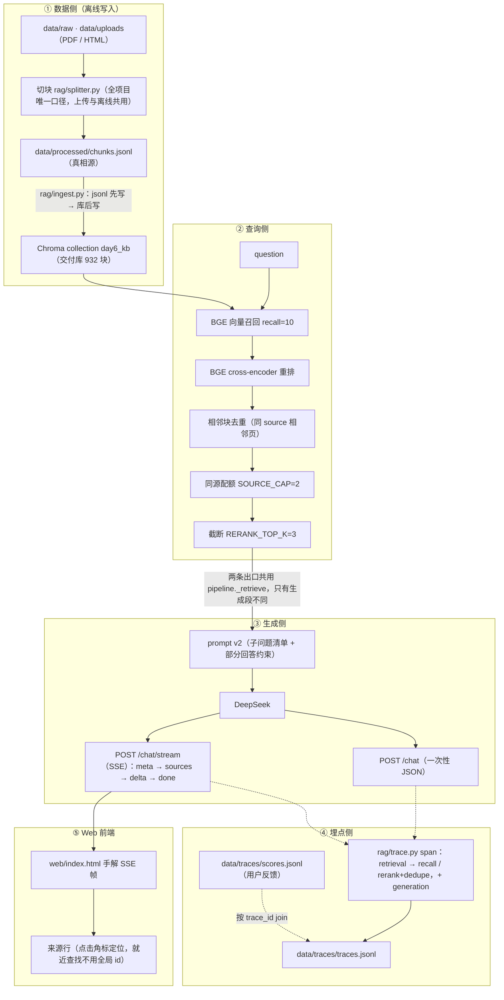

# rag-kb — 本地 RAG 知识库问答

> 一个纯本地跑的检索增强问答服务：上传自己的 PDF/网页 → 向量检索 + 重排 → 大模型流式作答，
> 每条回答都带可点开的来源角标，全链路有 trace 可复盘。

有人可能会问：为什么不用现成的 LangChain？因为这个项目的目的就是把链路的每一层亲手写一遍 ——
切块、编码、召回、重排、去重、配额、prompt、SSE 帧、埋点、评测，全部是自己实现的，
出问题时能定位到具体一行，而不是猜框架里发生了什么。

## 快速开始

环境复用 9 月的那套 venv（`C:\Users\xx\Desktop\python\.venv`），三个必须知道的约束：

```powershell
# 1) 必须用项目 venv 的解释器（系统 python 里没有 chromadb）
# 2) 包内代码必须用 python -m 方式跑（相对导入），且 cwd = 项目根 rag-kb
# 3) 必须关闭沙箱，否则 chroma.sqlite3 报 disk I/O error
& "C:\Users\xx\Desktop\python\.venv\Scripts\python.exe" -m rag.eval
```

```powershell
# 起服务（项目根 rag-kb 下）
uvicorn api.main:app --port 8000
# Swagger 自测： http://127.0.0.1:8000/docs
# 前端（双标签页：知识库管理 / 问答）： http://127.0.0.1:8000/
```

## 架构



## 接口一览

| 方法 | 路径 | 说明 |
|---|---|---|
| GET | `/health` | 探活 + 库内块数 + 默认 top_k |
| POST | `/chat` | 一次问答，返回结构化结果（含 trace_id） |
| POST | `/chat/stream` | 同链路的 SSE 流式版（meta → sources → delta… → done） |
| POST | `/files` | 上传 PDF → 解析 → 切块 → 写真相源 → 入库 |
| POST | `/ingest` | 拿真相源全量 upsert 进库（**注意：只多不减，见已知局限**） |
| POST | `/feedback` | 给某条 trace 补 👍/👎 |
| GET | `/documents` | 按 source 聚合「库里有哪些资料」 |
| GET | `/docs` / `/` | Swagger / 静态前端 |

## 效果指标

跑法：`python -m rag.eval final`（结果落盘 `data/eval_day14.json`，验收脚本第 2 行直接读它）。

| 指标 | final 交付口径（本次实测） | Day10 C 组（上一次，⚠️ 不可直接比） |
|---|---|---|
| 答案正确率 | **96.7%**（29/30） | 100%（30/30） |
| 　└ 分题型 | in 10/10 · cross 7/8 · partial 5/5 · out 7/7 | — |
| 引用正确率（有效引用 / 引用总数） | **93.3%**（125/134） | 94.1% |
| 引用覆盖率（有效引用 / top_k） | **55.6%**（50/90） | 52.2% |
| 零引用题 | 2（均为 out 题，正确拒答） | 4 |

| 成本 / 性能 | |
|---|---|
| 平均检索 | 190ms（含首调用冷启动 2134ms；剔除后稳态 **≈123ms**） |
| 平均生成 | 1401ms |
| 平均 token | 输入 749 / 输出 209 |
| 单次成本 | ¥0.0012 |

> **为什么两组数字不能直接比**：Day10 C 组的 100% / 94.1% / 52.2% 是在 **531 块库**上跑的；
> 之后 Redis 笔记 401 块入库（531 → 932），**证据池变了**，同一套题面对的资料不同，差距里混着「库变了」这个变量。
> 唯一能读的是方向：库变大后答案正确率 −3.3pt、引用正确率 −0.8pt，而引用覆盖率 **+3.4pt** ——
> 候选变多给了模型更多可引之处，也多了被误引的机会（本次唯一错题是第 18 题 cross：编造了「URL / 语言 / 标签」三种过滤维度）。

**口径声明（缺一条，上面的数字就不能复现）**

① **库版本**：测试时 collection=`day6_kb`，**932 块 == chunks.jsonl 行数**（验收表「前置·库内容 == chunks.jsonl」逐项核对过）。
② **参数口径**：`dedupe=True, top_k=3, quota_cap=2, prompt=v2` —— 即**服务默认值**（Day14 起 cross 题也走 3，不再读已否的 `CROSS_TOP_K`），所以这张表同时就是「服务默认行为」。
③ **随机源**：`temperature=0`，但 DeepSeek 不保证逐字确定（实测同题两次 completion token 24 vs 34），**±1 题级别的抖动属底噪**，不要拿 0.1pt 的差当结论。
④ **题集**：30 题固定测试集（in 10 / cross 8 / partial 5 / out 7），与 Day9 起口径一致，换题集则全部指标作废。

## 验收

验收不是「我看过了，能跑」—— 是脚本化的一键证据：

```powershell
# 另开终端起服务后
& "C:\Users\xx\Desktop\python\.venv\Scripts\python.exe" scripts/09_acceptance.py
```

结果（2026-09-28 16:28，库 932 块）：**14 PASS / 0 FAIL / 1 人工+待办**

```text
阶段总验收  2026-09-28 16:28:16  服务 http://127.0.0.1:8000
====================================================================================================
验收项                                    结果          证据
----------------------------------------------------------------------------------------------------
4 API·/docs 可交互                        PASS          HTTP 200
4 API·/health 200                         PASS          status=ok collection=day6_kb chunks=932 default_top_k=3
前置·库内容 == chunks.jsonl               PASS          collection 932 vs 真相源 932 行
1 端到端·首 token <2s（稳态）             PASS          稳态 1601ms / 冷启动 2607ms（均含检索，从发出请求算起）
1 端到端·sources 先于 delta               PASS          Day13 定的顺序契约，今天第一次被自动断言
1 端到端·回答带来源角标 [n]               PASS          3 个来源 / 回答 414 字
1 端到端·库外拒答 2/2                     PASS(初判)    自动判据只能证明「没说带引用的话」，编造与否见人工复核区
2 效果基线·答案/引用 ≥80%                 PASS          acc 96.7% / cite 93.3% / 覆盖 55.6%（day6_kb @ 932 块）
可观测·trace 含检索+生成 span 与成本      PASS          20260928-162813-7b7d spans=['generation', 'recall', 'rerank+dedupe', 'retrieval'] 成本 ¥0.0007
可观测·有效用户反馈 ≥3                    PASS          有效 10 条（👍8 / 👎2），孤儿 1 条 ['20260101-000000-dead']
.env 存在且有 .env.example                PASS          .env + .env.example 均在项目根（前者不入库、后者给模板）
.gitignore 忽略 .env                      PASS          按【整行】匹配：用子串 ".env" in text 会被 .env.example 误判成已忽略
.env 未被 git 跟踪                        PASS          git ls-files 共 44 个文件，其中无 .env
工程规范·requirements 版本可复现          PASS          7 个钉版本，全部一致；未列出但实装：transformers/httpx（可复现缺口）
5 概念口述 5 题                           MANUAL        见 README「面试可讲的 5 个问题」
----------------------------------------------------------------------------------------------------
PASS 14 / FAIL 0 / 人工+待办 1

====================================================================================================
人工复核区（自动判据只当筛子，不当法官）
====================================================================================================
【需人工复核】库外题「我家的洗衣机显示 E4 错误码，该怎么修？」
  机器初判：拒答（判据=含拒答语 且 无 [n]）
  原文：资料未涉及洗衣机 E4 错误码的维修方法。

【需人工复核】库外题「2026 年世界杯的冠军是哪支球队？」
  机器初判：拒答（判据=含拒答语 且 无 [n]）
  原文：**子问题清单**
1. 2026 年世界杯的冠军是哪支球队？

**逐条回答**
1. 资料未涉及 2026 年世界杯冠军的相关内容。
```

其中两条实测数据值得单独说：
- **首 token：稳态 1601ms / 冷启动首请求 2607ms**（本轮实测，冷启动约 1.6 倍）。验收线 2s 判定用稳态，
  但冷启动值如实附上：只报好看的那个数字就是自欺。**同一个 932 块库、同一道题，14:32 那轮是
  稳态 846ms / 冷启动 2087ms** —— 两轮差异本身就是结论：这个指标含网络与 GPU 首次编译的抖动，
  单次数值不能当基线，要看多轮量级。
- **上传闭环**（2026-09-28 手工跑，未纳入 09_acceptance.py）：上传 91 页 PDF → 0 丢页 → 339 块 →
  库 932→1271 → 提问命中新内容（top-3 里 2 条来自新文件，回答正确并带 [1] 角标）。
  验收后**已回滚**，交付库保持 932 块，与指标锚定的库版本一致。

## 可观测

自研本地 trace（Day10 曾计划接 Langfuse，后改自研，四个概念一一对应）：

| Langfuse 概念 | 本项目实现 | 落盘位置 |
|---|---|---|
| trace | 一次问答的完整记录（trace_id 形如 `20260926-213450-a41c`） | `data/traces/traces.jsonl` |
| span | `retrieval`（父）→ `recall` / `rerank+dedupe`（子） | 同上，spans 数组 |
| generation | 生成段的模型、token 数、成本 | 同上，spans + totals |
| score | 用户 👍/👎，按 `trace_id` join 回 trace | `data/traces/scores.jsonl` |

为什么自研：四概念本来就够简单，接第三方 SDK 反而把「帧顺序」「span 跨 yield」这些真正要理解的地方藏起来了。
代价见已知局限 —— 没有现成的看板，得自己读 jsonl。

## 已知局限

① 切块跨页切断：章节标题落在 N 页页尾、正文在 N+1 页开头时被物理切断
  （build_chunks 逐页切、add_overlap 绝不跨记录、chunk_id 带页码；MIN_CHARS=100 只在页级生效，块级无最小长度过滤）。
  实测 Redis 笔记 401 块里有 20 个 <100 字短块，全是「页尾内容 + 同一句广告水印」。
  候选治法 A 去页眉页脚 / B 孤块缝合 / C 标题传播（拼进 embedding 输入、库内 text 不动）——
  动口径即 932 块重建 + 全部指标不可比，故本阶段不动只记录。

② POST /ingest 是 upsert-only：库比真相源【多】时它删不掉多余块（「重建」只在真相源 ⊇ 库时成立）。
  真正的恢复路径是换库目录/删集合 + 重建。

③ Chroma HNSW 索引在「写入后 compaction 未落盘即杀进程」时会损坏（已发生 4 次，2026-09-26 第 4 次连
  count() 都失败）。缓解：真相源先行 + 换目录重建（932 块重建实测 13.8s）；
  纪律：任何写操作（上传/删除/重建）之后要等进程正常退出，不要强杀。

④ 代码型 PDF 切块效果差：react 那份 91 页 PDF 出了 339 块，其中大量代码页按 300 字硬切，
  语义被打散（中文占比仅 22%）。它只用于上传验收，未进交付库。

⑤ requirements 可复现缺口：只钉了 7 个包，实测 transformers / httpx 未列出，
  且 venv 是 --system-site-packages（torch 等继承包不出现在 pip freeze 里）——
  别人照 requirements.txt 装不出可运行环境。

⑥ 没有鉴权、没有并发控制：/ingest 与 /chat 都可被并发调用；上传是同步长任务（91 页 31s），
  真实生产要改后台任务 + 任务 id 轮询。

## 目录结构

```
rag-kb/
├─ api/main.py          FastAPI 路由（/health /chat /chat/stream /files /ingest /feedback /documents）
├─ rag/
│  ├─ config.py         全项目唯一的参数/常量出口
│  ├─ splitter.py       切块口径（唯一来源，上传与离线共用）
│  ├─ embedding.py      BGE 编码（CLS 池化 + L2 归一化）
│  ├─ ingest.py         chunks.jsonl → Chroma（真相源唯一写入口 save_chunks）
│  ├─ retriever.py      召回 / 重排 / 相邻去重 / 同源配额
│  ├─ llm.py            DeepSeek 客户端、prompt、来源格式化
│  ├─ pipeline.py       编排：召回→精排→去重→截断→生成（一次性 / 流式共用检索段）
│  ├─ trace.py          span 埋点 + score
│  └─ eval.py           30 题评测（三组对照 / 检索层判决 / final 交付口径）
├─ scripts/             01…08 各日脚本；09_acceptance.py 阶段总验收
├─ web/index.html       前端（手解 SSE 帧、角标定位来源行）
└─ data/                raw/uploads（原始）、processed/chunks.jsonl（真相源）、traces、eval_*.json
```

## 面试可讲的 5 个问题（验收 #5 自测）

1. 两阶段链路为什么不是「召回即答案」？向量召回与 cross-encoder 重排各自在解决什么？
2. 双塔（bi-encoder）与 cross-encoder 的结构差异，以及「为什么不能全用 cross-encoder」？
3. chunk size 的取舍：太大丢精度、太小断语义 —— 你怎么定，怎么验证？
4. HNSW 是什么？近似最近邻的「近似」代价体现在哪？
5. 三个指标各自的分母是什么？为什么引用覆盖率的分母必须固定为 top_k？

## 简历 bullet

**本地 RAG 知识库问答系统**（Python / FastAPI / Chroma / BGE / DeepSeek）：独立实现「PDF 切块 → 向量召回 →
cross-encoder 精排 → 相邻块去重 → 同源配额截断 → SSE 流式作答」的两阶段检索链路，以及上传入库、来源角标
定位、trace 埋点（检索/生成 span、token 与成本）三块配套能力；全链路未依赖 LangChain 等框架，切块口径、
SSE 帧拼解、30 题评测体系均自实现，出问题可定位到具体一行代码；在 932 块自建语料（4 份资料）上，30 题固定
测试集实测答案正确率 96.7%、引用正确率 93.3%、引用覆盖率 55.6%，首 token 稳态 <2s（实测 0.8–1.6s，含网络
抖动），单次问答成本约 ¥0.0012。