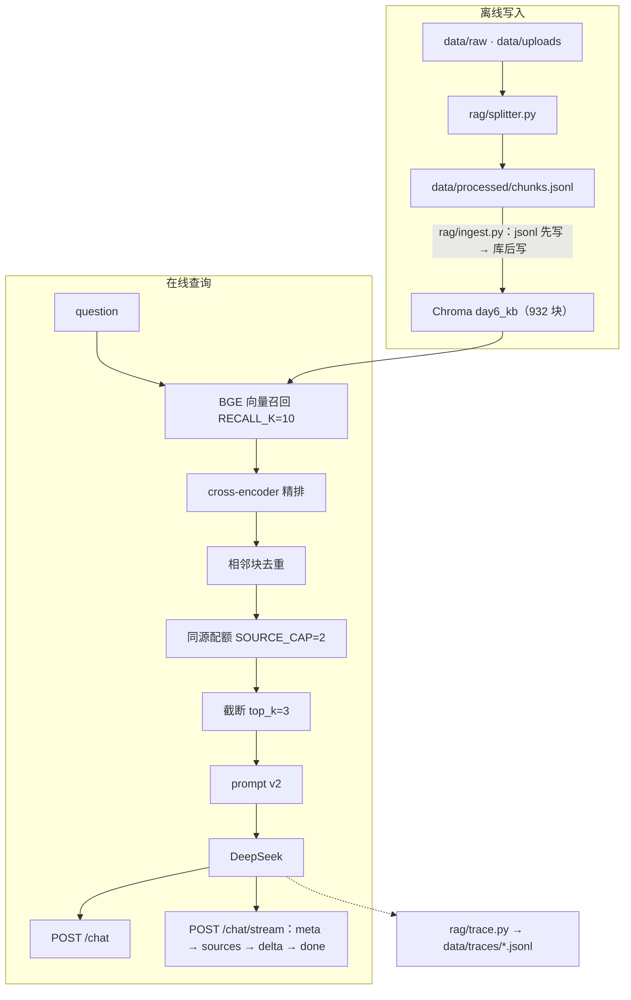

# rag-kb-next — 可复现的 RAG 检索与评测 harness

> 不依赖 LangChain 的本地 RAG 知识库：PDF 上传 → 切块 → 向量召回 → cross-encoder 精排 →
> 去重/同源配额 → 引用式回答（JSON / SSE）→ trace 埋点 → 冻结评测集与回归门禁。
>
> **932 块语料 · 30 题冻结集 · 7 项门禁（本机约 1 分钟，热缓存最快 17s）**。四个候选优化方案
> （混合检索 / 换 embedding+reranker / Contextual Retrieval / Agentic 循环）都被自己的对照数据否掉，
> 默认链路每一项都有实测支撑；语义缓存是唯一保留的正收益能力（第二趟 token 0.03×、7.5ms），
> 但**尚未接入默认 `/chat`**。

## 目录

- [它是什么](#它是什么)
- [30 秒看懂](#30-秒看懂)
- [负结果决策表](#负结果决策表)
- [快速开始](#快速开始)
- [架构](#架构)
- [评测体系与结果](#评测体系与结果)
- [MCP 与安全](#mcp-与安全)
- [API](#api)
- [可观测](#可观测)
- [已知局限](#已知局限)
- [目录结构](#目录结构)
- [FAQ](#faq)
- [证据索引](#证据索引)

## 它是什么

- **一个可本地运行的 RAG 服务**：`POST /chat` 一次性问答、`POST /chat/stream` SSE 流式、
  `POST /files` 上传 PDF、`GET /documents` 文档列表、`POST /feedback` 用户反馈；
  前端是双标签页（知识库管理 / 问答），后端是 FastAPI。
- **一条可复现的评测链**：`frozen_v2` 30 题冻结集、页级/来源级 gold、检索层与生成层分开、
  判官与被测模型不同家族、`pytest` 回归门禁。
- **一份负结果决策记录**：四个方案都先写预注册目标再跑对照，全部被数据否掉；
  每个否掉的方案都保留开关，并写清“何时该开”。
- **一个 MCP server**：`search_knowledge_base` / `ask_knowledge_base` 两个只读工具，
  可被 Claude Code 等外部 Agent 调用。

**不是什么**：不是 LangChain 封装 demo；不是生产级多租户系统（无鉴权、无并发控制、
上传/入库仍是同步长任务）；不是大规模语料 benchmark（932 块、30 题，规模与口径都有限）。

### 为什么不用 LangChain

项目的目的就是把链路的每一层亲手写一遍：切块、编码、召回、重排、去重、配额、prompt、
SSE 帧、埋点、评测。出问题时能定位到具体一行，而不是猜框架里发生了什么。

## 30 秒看懂

| 维度 | 现状 | 证据 |
|---|---|---|
| 默认检索 | dense + BGE 精排 + 相邻块去重 + 同源配额 2 + top_k=3 | `rag/config.py`、`rag/pipeline.py` |
| 默认生成 | DeepSeek + prompt v2（子问题清单 + 部分回答 + 引用编号） | `rag/llm.py` |
| 质量（frozen_v2） | 答案 27/30；引用正确率 99.1%；`cite_at_k` 73.3%；principle 2/5 | `data/frozen_v2_generation.json` |
| 成本/延迟 | 检索 114ms / 生成 1668ms；30 题生成 ¥0.0447 | 同上 |
| 回归门禁 | 7 项：6 项数据不变量 + 1 项逐题严格全等；本机约 1 分钟（热缓存最快 17s） | `tests/` |
| 未接默认链路 | hybrid、Qwen3/v2-m3、Contextual、Agentic、语义缓存 | 负结果决策表 |

| 能力 | 状态 |
|---|---|
| `/chat`、`/chat/stream`、`/files`、`/documents`、`/feedback`、trace | 已上线 |
| `RETRIEVAL_MODE="hybrid"` | 开关可用，默认锁 `dense` |
| Qwen3-Embedding / v2-m3 精排 / Contextual Retrieval | 实验代码与参数保留，默认不用 |
| Agentic RAG（`rag/agentic.py`） | 实验保留，未接默认 `/chat` |
| 语义缓存（`rag/cache.py`） | 能力保留，未接默认 `/chat` |

## 负结果决策表

四个方案都先写预注册目标、再跑对照；全部被自己的数据否掉，但开关都保留——
负结果必须与“何时该开”成对出现，否则会被误读成“没做完”。

| 方案 | 预注册目标 | 实测 | 判决 | 开关 | 何时该开 |
|---|---|---|---|---|---|
| 混合检索 dense+BM25→RRF | in recall@5 +8pt | +4.17pt（仅救回 1 块，落 rank 4 截断外）；召回延迟 +30% | 默认锁 dense | `RETRIEVAL_MODE="hybrid"` | 语料换成大量型号/专有名词时 |
| Qwen3-Embedding + v2-m3 精排 | 质量换延迟 | 净覆盖≈0、cross 1.0→0.9；精排不动 recall；两轴同换延迟 3.7× | 三件套不改 | `EMBED_MODELS` 注册表 + 精排模型参数 | 显存升级 + 有 cross 类新语料时 |
| Contextual Retrieval | 降检索失败率 | in +1 块落 rank 4；cross 1.0→0.9；同源坍缩 | 不上 | `EMBED_MODELS["bge-small-zh"].variants["ctx"]` | 语料以长文档单源为主时 |
| Agentic RAG 上线 | cross 有增益 | token 2.61× / 成本 2.17× / 延迟 2.73×；A 19/20 vs C 18/20 | 不上，仅保留缓存能力 | `rag/agentic.py` 的 `GroupParams` | 真多跳、跨文档集且能接受 2× 成本时 |

> 口径：前三行来自 W1/W2 的 20 题 tune 集；Agentic 行来自 W4 的 20 题 × 5 组。
> 与 `frozen_v2` 的 30 题不可跨集比较。

## 快速开始

> 主路径按通用环境写；作者本机的绝对路径、`-m` 运行约定与沙箱约束放在本节末尾折叠块。

### 1. 环境

- Python 3.13（本机实测）；建议本地 GPU，BGE/reranker 在 CPU 上会明显变慢。
- 默认链路模型：`bge-small-zh` + `bge-reranker-base`；`Qwen3-Embedding-0.6B` 仅 W2 对照需要。
- API：`DEEPSEEK_API_KEY`（作答）、`DASHSCOPE_API_KEY`（判分）。
- `requirements.txt` 钉了 10 个包；`torch`、`transformers`、`httpx`、`beautifulsoup4`
  未列入，需要按本机环境另装（见[已知局限](#已知局限) ⑤）。

```powershell
python -m venv .venv
.\.venv\Scripts\Activate.ps1
pip install -r requirements.txt
pip install httpx beautifulsoup4
# torch / transformers 按本机 CUDA 版本安装（requirements 未钉版本）
```

### 2. 配置

```powershell
Copy-Item .env.example .env
# 填入 DEEPSEEK_API_KEY / DASHSCOPE_API_KEY
```

模型路径不是自动下载，写在 `rag/config.py`：

- `EMBED_MODELS["bge-small-zh"]["path"]` → 本地 bge-small-zh 目录；
- `RERANKER_MODEL_PATH` → 本地 bge-reranker-base 目录；
- `EMBED_MODELS["qwen3-0.6b"]["path"]` → 仅跑 W2 对照时需要。

### 3. 数据与建库

仓库自带 `data/processed/chunks.jsonl`（932 行，真相源）；`chroma_db/`、`data/raw/`、
`data/uploads/` 不入库。首次启动后调用 `/ingest` 重建向量库：

```powershell
uvicorn api.main:app --port 8000
# 另一个终端
Invoke-RestMethod -Method Post http://127.0.0.1:8000/ingest
```

若要从原始文件重新生成真相源：

```powershell
# 先把 PDF / HTML 放进 data/raw/
python scripts/03_load_pdf.py extract
python scripts/04_load_web.py extract
python scripts/05_split.py split 300
```

`POST /ingest` 是 **upsert-only**：库比真相源多的块删不掉；要真正重建，删集合或换库目录。

### 4. 启动

```powershell
uvicorn api.main:app --port 8000
# 前端：  http://127.0.0.1:8000/
# Swagger：http://127.0.0.1:8000/docs
python -m rag.cli "RAG 有哪些局限性？"
```

### 5. 复现分级

| 级别 | 命令 | 说明 |
|---|---|---|
| 零 API | `python -m pytest -m "not slow" -q` | 6 项数据不变量，毫秒级，不需要 GPU |
| 零 API | `python -m pytest -q` | 7 项；本机实测约 70s，含 1 项 GPU 慢测；热缓存最快 17s，冷启动 1–2 分钟 |
| 零 API | `python scripts/23_eval_frozen_v2.py --check` | 检索层逐题严格全等；需要 GPU、模型与已有基线 |
| 零 API | `python scripts/24_trajectory_stats.py` | 只读 W4 轨迹，重算 `reports/w5_trajectory.md` |
| 低 API | `python scripts/26_w4_rejudge.py` | 只判分不生成（约 80 次判分） |
| 高 API | `python scripts/25_eval_frozen_v2_answer.py --limit 5` | 生成层冒烟；结果文件已存在时需 `--force` 才覆盖 |
| 高 API | `python -m rag.eval final` / `python scripts/20_agentic_ab.py` | Day14 / W4 历史实验，花钱且耗时长 |

<details>
<summary>作者本机环境（Windows / Trae 沙箱）</summary>

- 解释器：`C:\Users\xx\Desktop\python\.venv\Scripts\python.exe`
- 工作目录：`c:\Users\xx\Desktop\python\Agent学习\RAG\rag-kb-next`
- 包内代码用 `python -m` 运行（相对导入），例如 `python -m rag.eval`；
- 访问 Chroma 必须关闭沙箱，否则 `chroma.sqlite3` 报 disk I/O error；
- 任何写操作（上传/入库/重建）后等进程正常退出，不要强杀，避免 HNSW 索引损坏。

</details>

## 架构



一次请求的 8 步：

1. 用户问题进入 `POST /chat` 或 `POST /chat/stream`；
2. BGE 编码 query，Chroma 召回 `RECALL_K=10`；
3. cross-encoder 精排；
4. 相邻块去重（同 source 相邻页）；
5. 按 `SOURCE_CAP=2` 做同源配额；
6. 截断到 `RERANK_TOP_K=3`；
7. prompt v2 拼资料与问题；
8. 生成回答，同时写 trace（检索/生成 span、token、成本）。

`answer()` 与 `answer_stream()` 共用同一段 `_retrieve`，只有生成段不同。

## 评测体系与结果

### 题集速查

| 文件 | 题数 | 角色 |
|---|---|---|
| `data/testset_tune.jsonl` | 20 | 调参集；W1/W2/W4 的 A/B 只用它 |
| `data/frozen_v1.jsonl` | 10 | 初版冻结集（历史，只读） |
| `data/test_questions.jsonl` | 30 | 原始并集（20 调参 + 10 冻结），Day14 评测用它 |
| `data/frozen_v2.jsonl` | 30 | **交付冻结集**：`frozen_v1` 10 + 新写 20（id 31–50） |

> 一句话记忆：**20 调参 + `frozen_v1` 10 = 原始 30；`frozen_v2` = 同一批 `frozen_v1` 10 + 新写 20 = 30**。
> 两套只共享 `frozen_v1` 的 10 题，其余 20 题不同；跨集数字不可比。

### 检索层：frozen_v2（25 道 fact 题，零 API）

| 组 | dense recall@5 | hybrid recall@5 | dense MRR | hybrid MRR |
|---|---|---|---|---|
| in (8) | 0.4354 | 0.3938（−4.2pt） | 1.000 | 1.000 |
| cross (7) | 0.8571 | **0.9286（+7.1pt）** | 1.000 | 0.9286 |
| partial (5) | 0.8000 | 0.8000 | 0.900 | 0.800 |
| 召回延迟中位 | 26.7ms | 58.3ms | | |

hybrid 只救 cross，in 掉 4.2pt、partial 排序变差、召回延迟翻倍 ⇒ **`RETRIEVAL_MODE` 默认保持 dense**。
`recall@5` 必须在不截断的候选池上算；先按 `top_k=3` 截断再算，@5/@10 会恒等于 @3，是假数。

### 生成层：frozen_v2（30 题，judge = 百炼 `qwen3.8-max`）

| 指标 | 数值 | 口径 |
|---|---|---|
| 答案正确率 | **90.0%**（27/30） | fact 用“是否被资料支撑”，principle 用要点覆盖率 |
| 　└ 分题型 | in 8/8 · cross 7/7 · partial 5/5 · out 5/5 · **principle 2/5** | out 含 2 题“部分拒答” |
| 引用正确率 | **99.1%**（106/107） | 仅 in/cross/partial；out 考拒答、不进分母 |
| 引用覆盖率 `cite_at_k` | **73.3%**（44/60） | pooled：有效引用槽位 / top_k 槽位 |
| principle 覆盖率均值 | 65.0%，通过 2/5（阈值 ≥60%） | 判官只报命中编号，阈值在代码里判 |
| 生成 / 判分成本 | ¥0.0447 + ¥0.0449 | 判分比生成还贵 |
| 单次平均耗时 | 检索 114ms / 生成 1668ms | 30 题单轮，含首调用冷启动，不是基线 |

两条必须一起读的注脚：

1. **principle 2/5 是真实失分**：三题都停在 50% 覆盖率，漏的是“踩过坑才知道的深层要点”；
   不是 gate 或 judge 的 bug。
2. **out 5/5 含 2 道“部分拒答”**：26（RoPE vs 正弦编码）与 28（LoRA rank/alpha）库内其实有
   部分相关内容；按“out = 完全库外”的原始设计标注偏严，已登记在已知局限 ⑩。

判官身份与指纹写在 `data/frozen_v2_generation.json`：`judge=qwen3.8-max`、`temperature=0`、
`enable_thinking=false`、`principle_pass_threshold=0.6`，并记录题目与语料两个 sha256。

### 回归门禁

- **数据不变量 6 项**：分层配比、题干无位置泄漏、gold 指纹与语料一致、gold 记录口径、
  principle 题必须带 `reference`、基线与 config/题集指纹一致；
- **基线回归 1 项**：`scripts/23_eval_frozen_v2.py --check` 逐题比对 `chunk_id` 顺序 +
  `rerank_score` + 汇总指标，用严格 `!=`，两次独立重跑逐位相同；
- **延迟不进 CI**：冷热差约 4 倍，写死成门禁必然误报。

### W4 轨迹结论（100 条轨迹，零成本复用）

| 结论 | 数字 |
|---|---|
| C 组平均检索轮次 | 1.40（in 8/8 一轮即终止；触顶 3 题：id=10/22/27） |
| 改写是否有效 | 45 个改写轮：引入新 top-3 块 53.3%，但引入新 gold 仅 4.4% |
| 语义缓存 | D1 写 18/20、D2 命中 18/20；命中趟 7.5ms、LLM 调用 0、假命中 0 |
| 结构性未命中 | 2 题（id=7/11）均为 `gate_no_retrieve`，不是检索失败 |

逐题轨迹见 [reports/w5_trajectory.md](reports/w5_trajectory.md)。

### Day14 历史基线（折叠）

<details>
<summary>Day14 · 原始 30 题（`test_questions.jsonl`，非 frozen_v2）</summary>

跑法：`python -m rag.eval final`，结果落盘 `data/eval_day14.json`。

| 指标 | Day14 final |
|---|---|
| 答案正确率 | 96.7%（29/30） |
| 引用正确率 | 93.3%（125/134） |
| 引用覆盖率 | 55.6%（50/90） |
| 平均检索 / 生成 | 190ms（含冷启动 2134ms；稳态约 123ms）/ 1401ms |
| 平均 token / 单次成本 | 输入 749 / 输出 209；¥0.0012 |

> 本节用的是 `data/test_questions.jsonl` 的 30 题（20 调参 + `frozen_v1` 10），
> **不是 `frozen_v2`**；两套只共享 `frozen_v1` 的 10 题，数字不可跨集比较。

</details>

### 总验收

2026-09-28 在 932 块库上跑 `scripts/09_acceptance.py`：**14 PASS / 0 FAIL / 1 人工+待办**。
覆盖 `/health`、首 token <2s（稳态）、`sources` 先于 `delta`、库外拒答 2/2、答案/引用 ≥80%、
trace 含检索+生成 span、有效反馈 ≥3、`.env` 未被 git 跟踪等。验收项与证据列见
`scripts/09_acceptance.py`；生成层结果落盘 [data/eval_day14.json](data/eval_day14.json)。

## MCP 与安全

- 启动：`python -m mcp_server.server`（stdio）；`.mcp.json` 里是本机绝对路径，换机器需要改。
- 工具：`search_knowledge_base`（召回+精排+截断）与 `ask_knowledge_base`（检索+生成）；
  `RAGKB_DESC_TIER=full|minimal|meta` 切换三档工具描述。
- 工具描述三档触发率均 100% ⇒ 描述精简不是“提触发率”的手段；成本主项是工具调用轮次。
- 注入对抗：A（`v1-sec` 加固）**0/10 真劫持**；B（裸模型）**2/10**；C（search 原文）**10/10 夹带**。
  防护以**架构层为主**：只读工具面、无 exec/文件写/网络、单次补全无工具循环、检索/生成分离。

详见 [reports/w3_mcp_report.md](reports/w3_mcp_report.md) 与
[reports/injection_report.md](reports/injection_report.md)。

## API

| 方法 | 路径 | 说明 |
|---|---|---|
| GET | `/health` | 探活 + 库内块数 + 默认 top_k + `retrieval_mode` |
| POST | `/chat` | 一次问答，返回结构化结果（含 `trace_id`） |
| POST | `/chat/stream` | 同链路的 SSE：`meta → sources → delta… → done` |
| POST | `/files` | 上传 PDF → 解析 → 切块 → 写真相源 → 入库 |
| POST | `/ingest` | 拿真相源全量 upsert 进库（只多不减） |
| POST | `/feedback` | 给某条 trace 补 👍/👎 |
| GET | `/documents` | 按 source 聚合“库里有哪些资料” |
| GET | `/docs` / `/` | Swagger / 静态前端 |

`/chat` 请求体：`question`（必填）、`qtype`（默认 `in`）、`top_k`（留空 = `RERANK_TOP_K=3`）、
`quota_cap`（默认 2）、`prompt_version`（默认 `v2`）、`dedupe`（默认 `true`）、`trace`（默认 `true`）。

```powershell
$body = @{ question = "RAG 有哪些局限性？"; qtype = "in" } | ConvertTo-Json
Invoke-RestMethod -Method Post -Uri http://127.0.0.1:8000/chat `
  -ContentType "application/json" -Body $body
```

SSE 帧格式（每帧以一个空行结束）：

```text
event: meta
data: {"trace_id":"20260928-162813-7b7d", "top_k":3, ...}

event: sources
data: {"sources":[{"slot":1,"chunk_id":"...","source":"RAG知识.pdf","where":"第13页",...}]}

event: delta
data: {"text":"RAG 的主要局限包括"}

event: done
data: {"answer":"...", "prompt_tokens":..., "completion_tokens":..., "cost":...}
```

## 可观测

自研本地 trace（不接第三方 SDK，保留“帧顺序 / span 跨 yield”这些要理解的地方）：

| Langfuse 概念 | 本项目实现 | 落盘位置 |
|---|---|---|
| trace | 一次问答的完整记录（`trace_id` 形如 `20260928-162813-7b7d`） | `data/traces/traces.jsonl` |
| span | `retrieval`（父）→ `recall` / `rerank+dedupe`（子） | 同上，spans 数组 |
| generation | 生成段模型、token 数、成本 | 同上，spans + totals |
| score | 用户 👍/👎，按 `trace_id` join 回 trace | `data/traces/scores.jsonl` |

没有现成看板，读 jsonl 即可；这是自研的代价，换来的是一条链路全在自己的代码里。

## 已知局限

| # | 局限 | 现状/处理 |
|---|---|---|
| ① | 切块跨页切断：章节标题在页尾、正文在下一页时被物理切断 | 932 块重建 + 全部指标不可比，本阶段只登记 |
| ② | `POST /ingest` 是 upsert-only，库比真相源多时删不掉多余块 | 真正重建 = 换库目录/删集合 + 重建 |
| ③ | Chroma HNSW 在“写入后 compaction 未落盘即杀进程”时可能损坏 | 真相源先行 + 换目录重建；写操作后等进程正常退出 |
| ④ | 代码型 PDF 切块效果差：react 91 页 PDF 出 339 块，大量代码页按 300 字硬切 | 只用于上传验收，未进交付库 |
| ⑤ | requirements 可复现缺口：10 个包已钉，仍缺 `torch` / `transformers` / `httpx` / `beautifulsoup4` | 照 requirements 装不出完整环境；需按本机 CUDA 另装 |
| ⑥ | 没有鉴权、没有并发控制；上传/入库是同步长任务 | 真实生产要改后台任务 + 任务 id 轮询 |
| ⑦ | 历史生成层数字仍是同源 judge：Day14 与 W1–W4 的判分模型与被测模型同为 DeepSeek | 只作内部迭代，不得对外当结论；W5 起换 `qwen3.8-max` |
| ⑧ | 旧题集泄漏残留：`testset_tune` id=12 题干仍含“第 4 章” | 已用于调参且冻结不改，只登记；frozen_v2 起用正则拦截 |
| ⑨ | hybrid 不是没做，是实测不划算 | 开关一直可用；语料换成大量专有名词/型号时重跑对照再决定 |
| ⑩ | frozen_v2 的 out 题有 2 道标注偏严：26、28 库内有部分内容 | 冻结集不改，按题集问题登记；解读 out 5/5 时须扣除这 2 道 |

## 目录结构

```text
rag-kb-next/
├─ api/main.py          FastAPI 路由（/health /chat /chat/stream /files /ingest /feedback /documents）
├─ rag/
│  ├─ config.py         全项目唯一参数/常量出口（含 EMBED_MODELS 注册表、价格常量）
│  ├─ splitter.py       切块口径（唯一来源，上传与离线共用）
│  ├─ embedding.py      BGE 编码（CLS 池化 + L2 归一化）
│  ├─ ingest.py         chunks.jsonl → Chroma（真相源唯一写入口 save_chunks）
│  ├─ retriever.py      召回 / 重排 / 相邻去重 / 同源配额
│  ├─ bm25.py           jieba + BM25Okapi 稀疏召回
│  ├─ fusion.py         dense ⊕ BM25 → RRF
│  ├─ llm.py            DeepSeek 客户端、prompt、来源格式化
│  ├─ judge.py          判分（W5 起百炼 qwen3.8-max）
│  ├─ pipeline.py       编排：召回→精排→去重→截断→生成（JSON / 流式共用检索段）
│  ├─ agentic.py        W4 Agentic 循环（gate / 检索 / 自评 / 改写 / step cap=3）
│  ├─ cache.py          W4 语义缓存（namespace + 问题向量两层 key）
│  ├─ trace.py          span 埋点 + score
│  ├─ metrics.py        recall@k / MRR / nDCG@k / cite_at_k
│  ├─ gold.py           gold 生成与装载（tune / frozen_v2 两套）
│  └─ eval.py           30 题评测（三组对照 / 检索层判决 / final 交付口径）
├─ mcp_server/          MCP server（stdio）：server.py / tool_defs.py
├─ scripts/             01…26 各阶段实验与验收脚本
├─ tests/               pytest 门禁（数据不变量 + 检索层基线回归）
├─ reports/             W3 / W4 / W5 公开报告
├─ docs/                本地私有材料：阶段计划、出题规范、博客、测验（不入库）
├─ web/index.html       前端（手解 SSE 帧、角标定位来源行）
└─ data/                chunks.jsonl（真相源）、frozen_v2、traces、eval_*.json；
                        raw/uploads/chroma_db 不入库
```

建议阅读顺序：`rag/pipeline.py` → `rag/retriever.py` → `rag/config.py` → `rag/eval.py` → `tests/`。

## FAQ

- **`chroma.sqlite3` 报 disk I/O error**：关闭沙箱/安全软件；不要在写库过程中强杀进程。
- **`/health` 返回 `chunks=0`**：先 `POST /ingest`；若仍为 0，检查 `data/processed/chunks.jsonl`。
- **模型加载失败**：改 `rag/config.py` 里的 `EMBED_MODELS[...]["path"]` 与 `RERANKER_MODEL_PATH`。
- **`pytest` 太慢**：`python -m pytest -m "not slow" -q` 只跑 6 项数据不变量（毫秒级）。
- **SSE 被攒成一次性输出**：确认响应头有 `Cache-Control: no-cache` 与 `X-Accel-Buffering: no`。
- **端口占用**：`uvicorn api.main:app --port 8001`，前端同源访问无需改代码。

## 证据索引

| 结论 | 真相源 | 复现入口 |
|---|---|---|
| 检索层 dense vs hybrid | `data/frozen_v2_baseline.json` | `scripts/23_eval_frozen_v2.py --check` |
| 生成层 27/30、99.1%、73.3%、principle 2/5 | `data/frozen_v2_generation.json` | `scripts/25_eval_frozen_v2_answer.py` |
| W1 混合检索 +4.17pt、未进 top-3 | `data/eval_w1_ab.json` | `scripts/10_hybrid_ab.py`、`scripts/11_rescue_analysis.py` |
| W2 模型 / Contextual / MRL 对照 | `data/eval_w2_model_ab.json`、`eval_w2_contextual.json`、`eval_w2_mrl.json` | `scripts/16/17/18` |
| W3 工具描述三档 + 注入对抗 | [reports/w3_mcp_report.md](reports/w3_mcp_report.md)、[reports/injection_report.md](reports/injection_report.md) | `scripts/19_injection.py` |
| W4 Agentic 四组五趟 + 轨迹 | `data/eval_w4_agentic_stats_full.json`、`data/w4_agentic_traces_full.jsonl` | `scripts/20/21`、[reports/w4_agentic_report.md](reports/w4_agentic_report.md) |
| W4 轨迹统计 | [reports/w5_trajectory.md](reports/w5_trajectory.md) | `scripts/24_trajectory_stats.py` |
| Day14 总验收 / 历史基线 | `data/eval_day14.json` | `scripts/09_acceptance.py` |
| 冻结集与 gold | `data/frozen_v2.jsonl`、`data/gold_frozen_v2.json` | `tests/` |
