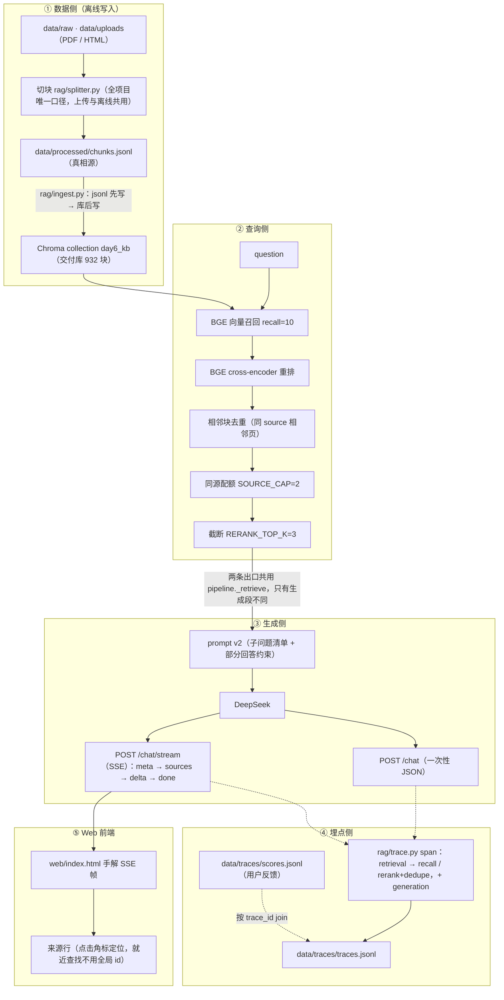

# rag-kb — 本地 RAG 知识库问答

> 一个纯本地跑的检索增强问答服务：上传自己的 PDF/网页 → 向量检索 + 重排 → 大模型流式作答，
> 每条回答都带可点开的来源角标，全链路有 trace 可复盘。

有人可能会问：为什么不用现成的 LangChain？因为这个项目的目的就是把链路的每一层亲手写一遍 ——
切块、编码、召回、重排、去重、配额、prompt、SSE 帧、埋点、评测，全部是自己实现的，
出问题时能定位到具体一行，而不是猜框架里发生了什么。

## 快速开始

环境复用 9 月的那套 venv（`C:\Users\xx\Desktop\python\.venv`），三个必须知道的约束：

```powershell
# 1) 必须用项目 venv 的解释器（系统 python 里没有 chromadb）
# 2) 包内代码必须用 python -m 方式跑（相对导入），且 cwd = 项目根 rag-kb-next
# 3) 必须关闭沙箱，否则 chroma.sqlite3 报 disk I/O error
& "C:\Users\xx\Desktop\python\.venv\Scripts\python.exe" -m rag.eval
```

```powershell
# 评测与门禁（零 API，约 17s）
& "C:\Users\xx\Desktop\python\.venv\Scripts\python.exe" scripts/23_eval_frozen_v2.py --check
& "C:\Users\xx\Desktop\python\.venv\Scripts\python.exe" -m pytest -q
# 生成层（花钱：DeepSeek 作答 + 百炼 qwen 判分，不进 CI；结果已存在需 --force）
& "C:\Users\xx\Desktop\python\.venv\Scripts\python.exe" scripts/25_eval_frozen_v2_answer.py
```

```powershell
# 起服务（项目根 rag-kb-next 下）
uvicorn api.main:app --port 8000
# Swagger 自测： http://127.0.0.1:8000/docs
# 前端（双标签页：知识库管理 / 问答）： http://127.0.0.1:8000/
```

## 架构



## 接口一览

| 方法 | 路径 | 说明 |
|---|---|---|
| GET | `/health` | 探活 + 库内块数 + 默认 top_k |
| POST | `/chat` | 一次问答，返回结构化结果（含 trace_id） |
| POST | `/chat/stream` | 同链路的 SSE 流式版（meta → sources → delta… → done） |
| POST | `/files` | 上传 PDF → 解析 → 切块 → 写真相源 → 入库 |
| POST | `/ingest` | 拿真相源全量 upsert 进库（**注意：只多不减，见已知局限**） |
| POST | `/feedback` | 给某条 trace 补 👍/👎 |
| GET | `/documents` | 按 source 聚合「库里有哪些资料」 |
| GET | `/docs` / `/` | Swagger / 静态前端 |

## 效果指标

跑法：`python -m rag.eval final`（结果落盘 `data/eval_day14.json`，验收脚本第 2 行直接读它）。

| 指标 | final 交付口径（本次实测） | Day10 C 组（上一次，⚠️ 不可直接比） |
|---|---|---|
| 答案正确率 | **96.7%**（29/30） | 100%（30/30） |
| 　└ 分题型 | in 10/10 · cross 7/8 · partial 5/5 · out 7/7 | — |
| 引用正确率（有效引用 / 引用总数） | **93.3%**（125/134） | 94.1% |
| 引用覆盖率（有效引用 / top_k） | **55.6%**（50/90） | 52.2% |
| 零引用题 | 2（均为 out 题，正确拒答） | 4 |

| 成本 / 性能 | |
|---|---|
| 平均检索 | 190ms（含首调用冷启动 2134ms；剔除后稳态 **≈123ms**） |
| 平均生成 | 1401ms |
| 平均 token | 输入 749 / 输出 209 |
| 单次成本 | ¥0.0012 |

> **为什么两组数字不能直接比**：Day10 C 组的 100% / 94.1% / 52.2% 是在 **531 块库**上跑的；
> 之后 Redis 笔记 401 块入库（531 → 932），**证据池变了**，同一套题面对的资料不同，差距里混着「库变了」这个变量。
> 唯一能读的是方向：库变大后答案正确率 −3.3pt、引用正确率 −0.8pt，而引用覆盖率 **+3.4pt** ——
> 候选变多给了模型更多可引之处，也多了被误引的机会（本次唯一错题是第 18 题 cross：编造了「URL / 语言 / 标签」三种过滤维度）。

**口径声明（缺一条，上面的数字就不能复现）**

① **库版本**：测试时 collection=`day6_kb`，**932 块 == chunks.jsonl 行数**（验收表「前置·库内容 == chunks.jsonl」逐项核对过）。
② **参数口径**：`dedupe=True, top_k=3, quota_cap=2, prompt=v2` —— 即**服务默认值**（Day14 起 cross 题也走 3，不再读已否的 `CROSS_TOP_K`），所以这张表同时就是「服务默认行为」。
③ **随机源**：`temperature=0`，但 DeepSeek 不保证逐字确定（实测同题两次 completion token 24 vs 34），**±1 题级别的抖动属底噪**，不要拿 0.1pt 的差当结论。
④ **题集**：30 题固定测试集（in 10 / cross 8 / partial 5 / out 7），与 Day9 起口径一致，换题集则全部指标作废。

## 冻结评测集 frozen_v2（W5）

> 与上面「效果指标」的区别：上面是 Day14 的 **tune 集 30 题**（可回改、用于调参）；
> 这里是 **frozen_v2 冻结集 30 题**（先写题、后跑分、sha256 锚定、不回改）。
> 两套题不重叠，数字**不可跨集比较**。

### 题集构成

| 层 | 题数 | gold 粒度 | 说明 |
|---|---|---|---|
| in | 8 | 页级（该页全部块） | 单文档可答 |
| cross | 7 | 来源级（文件名集合） | 必须两个来源 |
| partial | 5 | 来源级 | 一半在库、一半不在 |
| out | 5 | 空 | 库外，应拒答 |
| principle | 5 | 空 + `reference` 要点 | 通用原理题，**不要求检索** |

语义维度 `kind` 与题型正交：`fact` 25 题（in/cross/partial/out）+ `principle` 5 题。
前者参与 recall / MRR / nDCG / `cite_at_k`；后者只评答案质量、不检索、不计检索延迟。

冻结纪律：`data/frozen_v2.jsonl` 的 sha256 写进 `gold_frozen_v2.json` 与基线，
三者不一致时评测**拒绝运行**（不许静默用旧 gold）；"写完全部题 → 冻结 → 才允许跑模型 → 结果只读"。
出题规范见 [w5_question_spec.md](docs/w5_question_spec.md)，其中第 7 条是
**题干不得出现章节号/页码** —— 位置信息是 BM25 的精确词项，写在题干里等于给检索器塞
gold 附近的强信号，会人为抬高 recall / MRR；位置只允许写在 `expect`（判分侧，模型不可见）。

### 检索层：dense vs hybrid（25 fact 题，零 API）

| 组 | dense recall@5 | hybrid recall@5 | dense MRR | hybrid MRR |
|---|---|---|---|---|
| in (8) | 0.4354 | 0.3938（−4.2pt） | 1.000 | 1.000 |
| cross (7) | 0.8571 | **0.9286（+7.1pt）** | 1.000 | 0.9286 |
| partial (5) | 0.8000 | 0.8000 | 0.900 | 0.800 |
| 召回延迟中位 | 26.7ms | 58.3ms | | |

结论：hybrid 只救 cross（+7.1pt），in 掉 4.2pt、partial 排序变差、召回延迟翻倍
⇒ **`RETRIEVAL_MODE` 默认保持 dense**。这与 W1 在 tune 集上的 pilot 结论一致
（in recall@5 +4.17pt，未达预注册的 +8pt，且唯一救回块未进 top-3）。

> 为什么报 recall@5 而不是 @3：W1 的通关口子是 @5；若先按 `RERANK_TOP_K=3` 截断再算，
> @5/@10 会恒等于 @3（假数）。页级 gold 天然高估 recall（一页 3–5 块，命中任一块即算命中），
> 所以只能同口径横比（dense vs hybrid），不能当对外绝对值。

### 生成层：frozen_v2 实测（judge = 百炼 qwen3.8-max，与被测 DeepSeek 不同家族）

| 指标 | 数值 | 口径 |
|---|---|---|
| 答案正确率 | **90.0%**（27/30） | 全部 30 题；fact 用「是否被资料支撑」裁判，principle 用要点覆盖率 |
| 　└ 分题型 | in 8/8 · cross 7/7 · partial 5/5 · out 5/5 · **principle 2/5** | out 含 2 题「部分拒答」 |
| 引用正确率 | **99.1%**（106/107） | 仅 in/cross/partial（out 考拒答、不进引用分母），零引用题不进分母 |
| 引用覆盖率 `cite_at_k` | **73.3%**（44/60） | pooled：有效引用槽位 / top_k 槽位，不取比值平均 |
| 零引用题 | 2 / 25（均为 out，正确拒答） | fact 题 |
| principle 覆盖率均值 | 65.0%，通过 2/5（阈值 ≥60%） | 5 条 `reference` 要点，judge 只报命中编号、阈值在代码里判 |
| 生成 / 判分成本 | ¥0.0447 + ¥0.0449 | 生成 18.7k/6.5k token；判分 52.1k/1.6k token（判分比生成还贵） |
| 单次平均耗时 | 检索 114ms / 生成 1668ms | 30 题单轮，含首调用冷启动，**不是基线** |

结论与两条必须一起读的注脚：

1. **principle 2/5 是真实失分，不是判分 bug**。三题都停在 50% 覆盖率，漏的恰好是「本项目实测得来的深层要点」：
   46 号漏「检索层零 API 可复现 / 门禁成本低稳定」，48 号漏「命中绕过检索与自检 / 需按标注样本校准并留审计」，
   49 号漏「自评反复重查会把成本抬高 / 库小召回池高度重叠、多轮常无增益」。
   模型能把「表层两条」说对，说不到「踩过坑才知道的两条」—— 这正是 principle 维度想暴露的差距。
2. **out 的 5/5 含有 2 道「部分拒答」**：26 号（RoPE vs 正弦编码）与 28 号（LoRA rank/alpha）
   的资料里其实存在部分相关内容，模型拒答了库外部分、引用了库内部分，裁判判「未编造 + 该拒的都拒了」。
   按「out = 完全库外、应整题拒答」的原始设计，这两道题的 gold 标注偏严，属**题集问题**，已登记在已知局限 ⑩。

判官身份与可复现信息（都写进 `data/frozen_v2_generation.json`）：
`judge = qwen3.8-max`、`temperature=0`、`extra_body.enable_thinking=false`（该模型默认开深度思考，
不关会把 JSON 拖长且易污染）、`principle_pass_threshold=0.6`；同时记录题目与语料两个 sha256。
判分单价 `0.8 / 2.0 元每百万 token` 为占位值，只影响上表成本列、不影响判决。

### 回归门禁（pytest）

- **数据不变量 6 项**：分层配比、题干无位置泄漏、gold 指纹与语料一致、gold 记录口径、
  principle 题必须带 `reference`、基线与 config/题集指纹一致；
- **基线回归**：`scripts/23_eval_frozen_v2.py --check` 逐题比对 `chunk_id` 顺序 + `rerank_score`
  + 汇总指标，用严格 `!=`（不用 `isclose`），两次独立重跑逐位相同；
- **延迟不进 CI**：冷热差约 4 倍（首调用含 CUDA 编译 / HNSW 载入 / BM25 缓存加载），
  把延迟写死成门禁必然误报 —— 延迟只作为报告项，不作 pass/fail。

### W4 轨迹结论（100 条轨迹，零成本复用）

| 结论 | 数字 |
|---|---|
| C 组平均检索轮次 | 1.40（in 8/8 一轮即终止；触顶 3 题：id=10/22/27） |
| 改写是否有效 | 45 个改写轮：引入新 top-3 块 53.3%，但**引入新 gold 仅 4.4%（2/45）** |
| 语义缓存 | D1 写 18/20、D2 命中 18/20（写过的 100% 命中），命中趟 7.5ms、LLM 调用 0 |
| 结构性未命中 | 2 题（id=7/11）均为 `gate_no_retrieve`，不是检索失败 |

逐题轨迹附录见 [w5_trajectory.md](reports/w5_trajectory.md)。

## 验收

验收不是「我看过了，能跑」—— 是脚本化的一键证据：

```powershell
# 另开终端起服务后
& "C:\Users\xx\Desktop\python\.venv\Scripts\python.exe" scripts/09_acceptance.py
```

结果（2026-09-28 16:28，库 932 块）：**14 PASS / 0 FAIL / 1 人工+待办**

```text
阶段总验收  2026-09-28 16:28:16  服务 http://127.0.0.1:8000
====================================================================================================
验收项                                    结果          证据
----------------------------------------------------------------------------------------------------
4 API·/docs 可交互                        PASS          HTTP 200
4 API·/health 200                         PASS          status=ok collection=day6_kb chunks=932 default_top_k=3
前置·库内容 == chunks.jsonl               PASS          collection 932 vs 真相源 932 行
1 端到端·首 token <2s（稳态）             PASS          稳态 1601ms / 冷启动 2607ms（均含检索，从发出请求算起）
1 端到端·sources 先于 delta               PASS          Day13 定的顺序契约，今天第一次被自动断言
1 端到端·回答带来源角标 [n]               PASS          3 个来源 / 回答 414 字
1 端到端·库外拒答 2/2                     PASS(初判)    自动判据只能证明「没说带引用的话」，编造与否见人工复核区
2 效果基线·答案/引用 ≥80%                 PASS          acc 96.7% / cite 93.3% / 覆盖 55.6%（day6_kb @ 932 块）
可观测·trace 含检索+生成 span 与成本      PASS          20260928-162813-7b7d spans=['generation', 'recall', 'rerank+dedupe', 'retrieval'] 成本 ¥0.0007
可观测·有效用户反馈 ≥3                    PASS          有效 10 条（👍8 / 👎2），孤儿 1 条 ['20260101-000000-dead']
.env 存在且有 .env.example                PASS          .env + .env.example 均在项目根（前者不入库、后者给模板）
.gitignore 忽略 .env                      PASS          按【整行】匹配：用子串 ".env" in text 会被 .env.example 误判成已忽略
.env 未被 git 跟踪                        PASS          git ls-files 共 44 个文件，其中无 .env
工程规范·requirements 版本可复现          PASS          7 个钉版本，全部一致；未列出但实装：transformers/httpx（可复现缺口）
5 概念口述 5 题                           MANUAL        见 README「面试可讲的 5 个问题」
----------------------------------------------------------------------------------------------------
PASS 14 / FAIL 0 / 人工+待办 1

====================================================================================================
人工复核区（自动判据只当筛子，不当法官）
====================================================================================================
【需人工复核】库外题「我家的洗衣机显示 E4 错误码，该怎么修？」
  机器初判：拒答（判据=含拒答语 且 无 [n]）
  原文：资料未涉及洗衣机 E4 错误码的维修方法。

【需人工复核】库外题「2026 年世界杯的冠军是哪支球队？」
  机器初判：拒答（判据=含拒答语 且 无 [n]）
  原文：**子问题清单**
1. 2026 年世界杯的冠军是哪支球队？

**逐条回答**
1. 资料未涉及 2026 年世界杯冠军的相关内容。
```

其中两条实测数据值得单独说：
- **首 token：稳态 1601ms / 冷启动首请求 2607ms**（本轮实测，冷启动约 1.6 倍）。验收线 2s 判定用稳态，
  但冷启动值如实附上：只报好看的那个数字就是自欺。**同一个 932 块库、同一道题，14:32 那轮是
  稳态 846ms / 冷启动 2087ms** —— 两轮差异本身就是结论：这个指标含网络与 GPU 首次编译的抖动，
  单次数值不能当基线，要看多轮量级。
- **上传闭环**（2026-09-28 手工跑，未纳入 09_acceptance.py）：上传 91 页 PDF → 0 丢页 → 339 块 →
  库 932→1271 → 提问命中新内容（top-3 里 2 条来自新文件，回答正确并带 [1] 角标）。
  验收后**已回滚**，交付库保持 932 块，与指标锚定的库版本一致。

## 可观测

自研本地 trace（Day10 曾计划接 Langfuse，后改自研，四个概念一一对应）：

| Langfuse 概念 | 本项目实现 | 落盘位置 |
|---|---|---|
| trace | 一次问答的完整记录（trace_id 形如 `20260926-213450-a41c`） | `data/traces/traces.jsonl` |
| span | `retrieval`（父）→ `recall` / `rerank+dedupe`（子） | 同上，spans 数组 |
| generation | 生成段的模型、token 数、成本 | 同上，spans + totals |
| score | 用户 👍/👎，按 `trace_id` join 回 trace | `data/traces/scores.jsonl` |

为什么自研：四概念本来就够简单，接第三方 SDK 反而把「帧顺序」「span 跨 yield」这些真正要理解的地方藏起来了。
代价见已知局限 —— 没有现成的看板，得自己读 jsonl。

## 演进路线与结论索引（W1–W5）

五个强化周都是「一个变量 + 预注册预测 + 实测对照」，**负结果照样归档**：
测出「上了更差」也是结论，比堆功能更能说明工程判断。

| 周 | 做了什么 | 关键结论（全部实测） | 证据 |
|---|---|---|---|
| W1 | dense ⊕ BM25 → RRF 融合，接进 pipeline 开关 | in recall@5 **+4.17pt**（未达预注册 +8pt）；唯一救回块 `RAG知识_p123_c001` 只到 #4、没进 top-3 ⇒ 交付原料无变化；该 A/B 未预注册 ⇒ 降级为 pilot 证据 | `data/eval_w1_ab.json` |
| W2 | embedding × reranker 2×2 对照；Contextual Retrieval | 两轴**均无正拐点**（embedding 净覆盖≈0、cross 倒退；reranker 不动 recall@5），延迟 29.7 → 109.7ms（3.7×）⇒ 三件套不切；contextual 花 1.41 元、增益为负 ⇒ **不上** | `data/eval_w2_model_ab.json` / `eval_w2_contextual.json` |
| W3 | 知识库 MCP server 化（stdio）+ 工具描述三档 + 注入对抗 | 三档触发率均 **100%**，成本主项是**工具调用轮次**而非描述体积；注入 **10/10 未被劫持**，防护以**架构层为主、提示层为辅** | [w3_mcp_report.md](reports/w3_mcp_report.md)、[injection_report.md](reports/injection_report.md) |
| W4 | Agentic RAG 5 组 × 20 题 + 语义缓存 | 重检索触发率 **35%**（文献的 3.5–3.9×）、成本 **2.17×**、延迟 **2.73×**；D2 缓存 **0.08×** / 7.5ms；换 qwen 重判 A/C 均 **85%**，「A 错 C 对」由 0 例变 **1:1**（18 vs 11），净增益仍为 0 ⇒ 负结果不变 | [w4_agentic_report.md](reports/w4_agentic_report.md)、`data/eval_w4_agentic_rejudge_qwen.json` |
| W5 | frozen_v2 30 题冻结集 + eval harness + pytest 门禁 | 检索层 dense 优于 hybrid（见上一节）；生成层 27/30，**principle 2/5** 暴露「说得到表层、说不到实测深层」；门禁 7 项 17s，逐题严格全等 | [w5_question_spec.md](docs/w5_question_spec.md)、[w5_trajectory.md](reports/w5_trajectory.md)、[技术博客](docs/blog_w5_rag_eval.md)、[通关测验](docs/w5_quiz.md)、`data/frozen_v2_generation.json` |

一句话串起来：**默认链路（dense + bge-small + reranker-base + prompt v2）是逐项对照后留下来的，
不是拍脑袋选的**；每一个被否掉的方案（hybrid 默认、换大模型、contextual、Agentic 默认）都有数字支撑。

## 已知局限

① 切块跨页切断：章节标题落在 N 页页尾、正文在 N+1 页开头时被物理切断
  （build_chunks 逐页切、add_overlap 绝不跨记录、chunk_id 带页码；MIN_CHARS=100 只在页级生效，块级无最小长度过滤）。
  实测 Redis 笔记 401 块里有 20 个 <100 字短块，全是「页尾内容 + 同一句广告水印」。
  候选治法 A 去页眉页脚 / B 孤块缝合 / C 标题传播（拼进 embedding 输入、库内 text 不动）——
  动口径即 932 块重建 + 全部指标不可比，故本阶段不动只记录。

② POST /ingest 是 upsert-only：库比真相源【多】时它删不掉多余块（「重建」只在真相源 ⊇ 库时成立）。
  真正的恢复路径是换库目录/删集合 + 重建。

③ Chroma HNSW 索引在「写入后 compaction 未落盘即杀进程」时会损坏（已发生 4 次，2026-09-26 第 4 次连
  count() 都失败）。缓解：真相源先行 + 换目录重建（932 块重建实测 13.8s）；
  纪律：任何写操作（上传/删除/重建）之后要等进程正常退出，不要强杀。

④ 代码型 PDF 切块效果差：react 那份 91 页 PDF 出了 339 块，其中大量代码页按 300 字硬切，
  语义被打散（中文占比仅 22%）。它只用于上传验收，未进交付库。

⑤ requirements 可复现缺口：只钉了 7 个包，实测 transformers / httpx 未列出，
  且 venv 是 --system-site-packages（torch 等继承包不出现在 pip freeze 里）——
  别人照 requirements.txt 装不出可运行环境。

⑥ 没有鉴权、没有并发控制：/ingest 与 /chat 都可被并发调用；上传是同步长任务（91 页 31s），
  真实生产要改后台任务 + 任务 id 轮询。

⑦ **历史生成层数字仍是同源 judge**：Day14 与 W1–W4 的答案正确率/引用数字，判分模型与被测模型同为
  DeepSeek，存在 self-preference bias，**只作内部迭代、不得对外当结论**。W5 起已换百炼 qwen3.8-max
  （不同家族、固定模型名、关闭深度思考）：frozen_v2 生成层用新判官；W4 的 A/C 组也做了**零生成重判**
  （同一批轨迹、只重判），A 95%→85%、C 90%→85%，「A 错 C 对」从 0 例变 1:1。旧值保留不覆盖，两套不可直接比。

⑧ **旧题集的泄漏残留**：`testset_tune` 的 id=12 题干仍含「第 4 章」。该集已用于调参、且已冻结不改，
  只在报告里登记、不修；frozen_v2 起用正则拦截章节号/页码（见上一节），新题不会再犯。

⑨ **hybrid 不是没做，是实测不划算**：`RETRIEVAL_MODE=hybrid` 一直可用（W1 已接开关），
  但 frozen_v2 上只对 cross +7.1pt、in −4.2pt、召回延迟 ×2.2 ⇒ 默认锁 dense。
  若将来语料换成大量专有名词/型号（BM25 擅长、dense 易稀释），需要重新跑一次对照再决定。

⑩ **frozen_v2 的 out 题有 2 道标注偏严**：26（RoPE vs 正弦编码）与 28（LoRA rank/alpha）在库内
  其实有部分相关内容，模型「拒答库外 + 引用库内」被裁判判对；按「out = 完全库外」的原始设计，
  这两题的 gold 应拆成 partial。冻结集不改，按题集问题登记；解读 out 5/5 时须扣除这 2 道。

## 目录结构

```
rag-kb-next/
├─ api/main.py          FastAPI 路由（/health /chat /chat/stream /files /ingest /feedback /documents）
├─ rag/
│  ├─ config.py         全项目唯一的参数/常量出口（含 EMBED_MODELS 注册表、价格常量）
│  ├─ splitter.py       切块口径（唯一来源，上传与离线共用）
│  ├─ embedding.py      BGE 编码（CLS 池化 + L2 归一化，查询侧带 instruction）
│  ├─ ingest.py         chunks.jsonl → Chroma（真相源唯一写入口 save_chunks）
│  ├─ retriever.py      召回 / 重排 / 相邻去重 / 同源配额
│  ├─ bm25.py           jieba 分词 + BM25Okapi 稀疏召回（token 缓存带失效判据）
│  ├─ fusion.py         hybrid_retrieve()：dense ⊕ BM25 → RRF，mode 显式传参
│  ├─ llm.py            DeepSeek 客户端、prompt、来源格式化
│  ├─ judge.py          判分（当前 DeepSeek 同源；W5 卡3 换 qwen-plus）
│  ├─ pipeline.py       编排：召回→精排→去重→截断→生成（一次性 / 流式共用检索段）
│  ├─ agentic.py        W4 Agentic 循环（gate / 检索 / 自评 / 改写 / step cap=3）
│  ├─ cache.py          W4 语义缓存（namespace + 问题向量两层 key）
│  ├─ trace.py          span 埋点 + score
│  ├─ metrics.py        recall@k / MRR / nDCG@k / cite_at_k
│  ├─ gold.py           gold 生成与装载（tune / frozen_v2 两套，NO_GOLD_TYPES）
│  └─ eval.py           30 题评测（三组对照 / 检索层判决 / final 交付口径）
├─ mcp_server/          MCP server（stdio）：server.py / tool_defs.py
├─ scripts/             01…24 各阶段实验与验收脚本（09_acceptance / 10_hybrid_ab / 20_agentic_ab
│                       / 22_build_frozen_v2 / 23_eval_frozen_v2 / 24_trajectory_stats）
├─ tests/               pytest 门禁（frozen_v2 数据不变量 + 检索层基线回归）
├─ reports/             W3 / W4 / W5 汇总报告与注入报告
├─ docs/                阶段计划、出题规范、设计要点、quiz
├─ web/index.html       前端（手解 SSE 帧、角标定位来源行）
└─ data/                raw/uploads（原始）、processed/chunks.jsonl（真相源）、frozen_v2（冻结集
                        + gold + 基线）、traces、eval_*.json
```

## 面试可讲的 5 个问题（验收 #5 自测）

1. 两阶段链路为什么不是「召回即答案」？向量召回与 cross-encoder 重排各自在解决什么？
2. 双塔（bi-encoder）与 cross-encoder 的结构差异，以及「为什么不能全用 cross-encoder」？
3. chunk size 的取舍：太大丢精度、太小断语义 —— 你怎么定，怎么验证？
4. HNSW 是什么？近似最近邻的「近似」代价体现在哪？
5. 三个指标各自的分母是什么？为什么引用覆盖率的分母必须固定为 top_k？

## 简历 bullet

**本地 RAG 知识库问答系统**（Python / FastAPI / Chroma / BGE / DeepSeek / 百炼 qwen）：独立实现「PDF 切块 →
向量召回 → cross-encoder 精排 → 相邻块去重 → 同源配额截断 → SSE 流式作答」两阶段链路，以及上传入库、
来源角标定位、trace 埋点（检索/生成 span、token 与成本）三块配套能力；全链路不依赖 LangChain，切块口径、
SSE 帧拼解、评测体系均自实现，出问题可定位到具体一行；932 块自建语料上，30 题冻结集实测答案正确率
**90.0%**（27/30，判官为不同家族的 qwen3.8-max）、引用正确率 **99.1%**、引用覆盖率 **73.3%**，
首 token 稳态 <2s，单次问答成本约 ¥0.0012。

**评测与实验体系**（同一项目，2026H2 评测岗能力面）：自建 30 题冻结评测集（in/cross/partial/out/principle
分层 + sha256 指纹 + 先写题后跑分的版本纪律）与 **7 项 pytest 门禁**（17s 跑完、逐题严格全等、零 API 可复现，
延迟与生成层不进 CI）；把判官与被测模型解耦（不同家族 + 固定版本 + 关闭深度思考），实测同源判官会使
**3 题判决翻转**、「A 错 C 对」由 0 例变 1:1 ⇒ 所有对外数字带判官身份；另完成 MCP server 工具化与提示注入
对抗（10/10 未被劫持）、Agentic RAG 5 组 × 20 题对照（重检索触发率 35%、成本 2.17×、语义缓存第二趟 0.08×），
并据数据否掉 hybrid 默认、contextual retrieval 与 Agentic 上线，默认链路逐项有对照支撑。